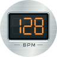
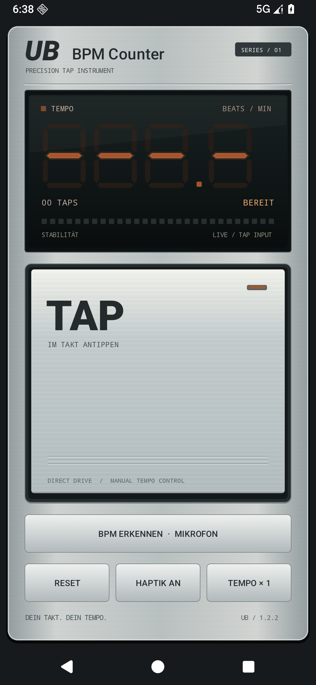

# UB BPM Counter



Ein kostenloser BPM-Zähler für Android im Stil klassischer 90er-Jahre-Musikgeräte: gebürstetes Silber, orange Siebensegment-Anzeige und eine große TAP-Fläche.

**[Fertige APK herunterladen](https://github.com/Unbasiert/UB-BPM-Counter/releases/latest/download/UB-BPM-Counter-v1.2.4.apk)** · [Alle Releases](https://github.com/Unbasiert/UB-BPM-Counter/releases) · [Build-Anleitung](docs/BUILD.md)

## Einfach installieren

1. Die APK über den Link oben auf dein Telefon herunterladen. Du kannst sie auch als Datei über Telegram übertragen.
2. Die APK öffnen und Android bei Bedarf die Installation aus dieser Quelle erlauben.
3. Installieren, öffnen und lostappen. Entwickleroptionen sind dafür nicht erforderlich.

Android 6.0 oder neuer. Die universelle APK läuft auf ARM, ARM64, x86 und x86_64. Ein Update aus diesem Repo kann über eine vorhandene, mit demselben Schlüssel signierte Version installiert werden.

## Was die App kann

- **Tap-Tempo:** Mit Daumen oder Fingern auf die große Fläche tippen. Nach etwa fünf regelmäßigen Taps steht ein brauchbarer Wert; längeres Tippen stabilisiert die Anzeige.
- **Mikrofon-Erkennung:** Musik über einen Lautsprecher abspielen und „BPM ERKENNEN · MIKROFON“ starten. Pegel und Stabilität helfen beim Ablesen.
- **Beat-LED:** Die kleine orange LED reagiert während der Erkennung auf aktuelle Audio-Attacks. Sobald ein Tempo erkannt ist, folgt ihr Blinkraster der angezeigten BPM.
- **Halb-/Doppeltempo**, optionale Tap-Haptik, Reset sowie Hoch- und Querformat.
- **Komplett offline:** Keine Werbung, kein Konto, kein Tracking, keine Internetberechtigung. Audiodaten werden nur im RAM verarbeitet und weder gespeichert noch übertragen.

Die Mikrofon-Erkennung braucht bei klarer Musik mehrere Sekunden für einen ersten BPM-Wert. Leise, unregelmäßige oder stark überlagerte Rhythmen können ohne Ergebnis bleiben. Halb- und Doppeltempo sind bei manchen Songs mehrdeutig. Beim Verlassen oder Drehen der App endet die Aufnahme; bei Bedarf erneut starten.



## Selbst bauen

Der dokumentierte Build läuft unter **Windows x64 mit PowerShell 5.1 oder neuer**. Ein Internetzugang wird beim ersten Lauf benötigt. **Android Studio und Gradle brauchst du nicht.**

```powershell
git clone https://github.com/Unbasiert/UB-BPM-Counter.git
cd UB-BPM-Counter
powershell -ExecutionPolicy Bypass -File .\scripts\build.ps1
```

Das Setup lädt ein portables Microsoft OpenJDK 21.0.12.1, Android SDK Build Tools 36.0.0 und Android Platform 36 r02 mit festgelegten SHA-256-Prüfsummen ausschließlich nach `.tools/`. Es installiert nichts global und ändert deinen PATH nicht. Die JDK-/SDK-Werkzeuge haben ihre eigenen Lizenzbedingungen; sie sind nicht Bestandteil dieses Public-Domain-Repos.

Ergebnis: `dist/UB-BPM-Counter-v1.2.4.apk` plus SHA-256-Datei. Weitere Builds funktionieren mit den bereits vorhandenen Werkzeugen offline:

```powershell
powershell -ExecutionPolicy Bypass -File .\scripts\build.ps1 -SkipSetup
```

Beim ersten eigenen Build wird ein neuer lokaler Signierschlüssel in `.signing/` erzeugt. **Schlüssel und Passwort privat sichern.** Sie werden nicht veröffentlicht. Dein selbst gebautes APK hat daher eine andere Signatur als die veröffentlichte APK; beim Wechsel zwischen beiden muss die zuvor installierte App deinstalliert werden.

Details zu Werkzeugen, Signierung und Audioanalyse stehen in [docs/BUILD.md](docs/BUILD.md).

## Tests

Nach dem Build lassen sich die Java-Tests ohne Telefon oder Emulator ausführen:

```powershell
powershell -ExecutionPolicy Bypass -File .\scripts\test-core.ps1
```

Sie prüfen Tap-Tempo, Audio-Tempo, Live-Beat-Signale und die LED-Pulsuhr. Android-UI-/Lebenszyklusprüfungen liegen zusätzlich unter `tests/instrumentation/`. Das zugehörige Skript benötigt eine separat vorbereitete lokale Emulator-/ADB-Umgebung; der normale Build lädt diese nicht mit.

## Public Domain und kein Support

Die App, ihr Quellcode und ihre eigenen Grafiken sind **Public Domain**, erklärt durch die [Unlicense](UNLICENSE). Du darfst sie verwenden, ändern, weitergeben oder verkaufen – ohne Namensnennung, Veröffentlichungspflicht oder sonstige Auflagen.

**Ich biete keinen Support und verspreche weder Wartung noch Updates.** Die App wird ohne Gewähr bereitgestellt. Wenn sie bei dir nicht läuft: Frag Claude oder Codex. Die dürfen den Quellcode lesen und das Problem beheben. LOL. 😄

Es gibt keinen Support-Issue-Tracker. Forks und eigene Verbesserungen sind willkommen; eine Reaktion auf Pull Requests ist nicht zugesagt.
